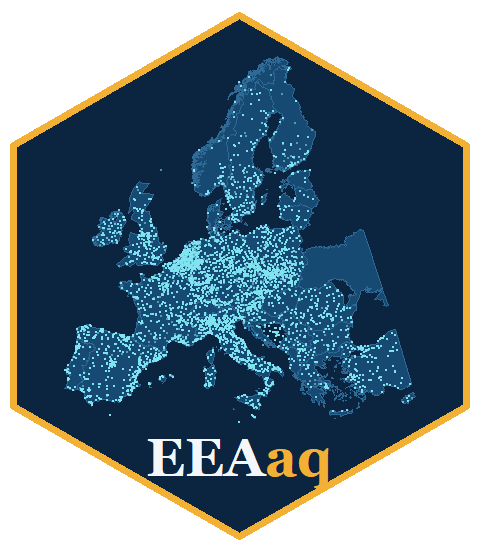
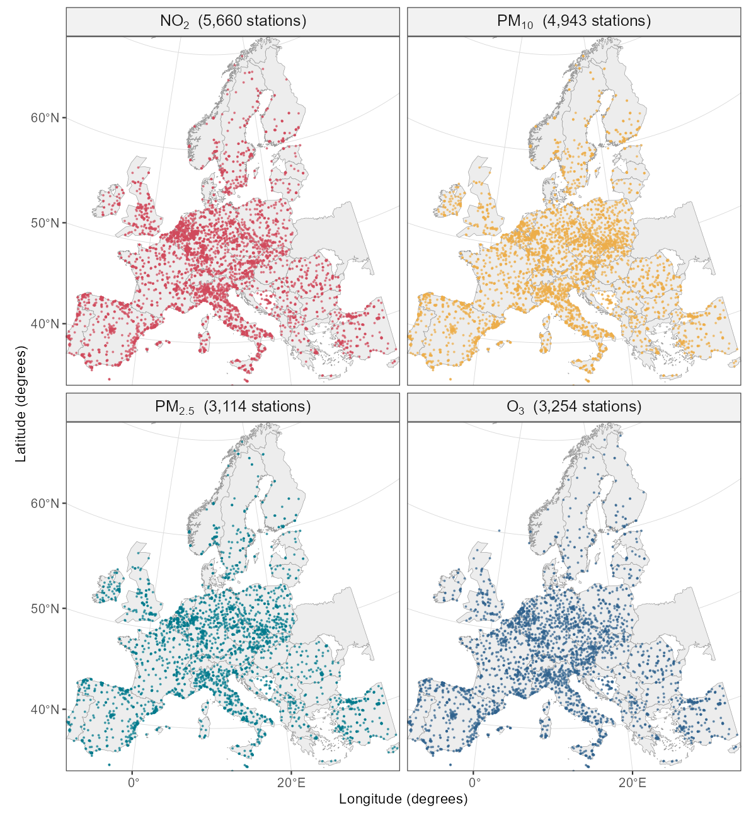
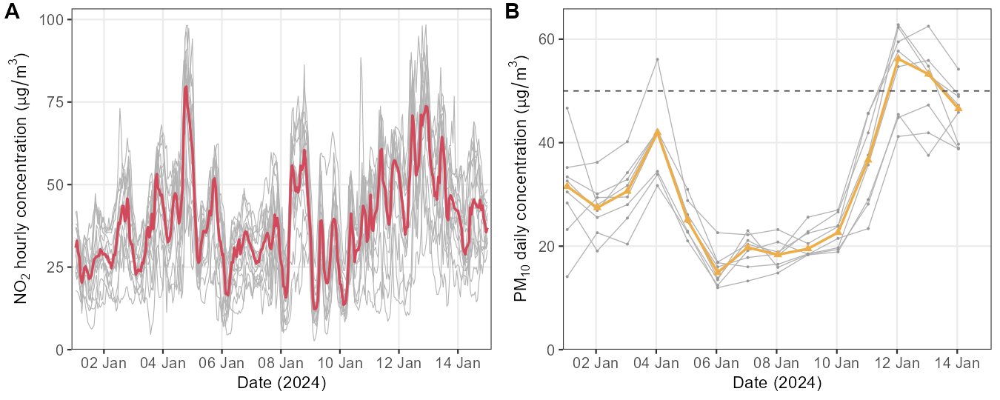

# EEAaq 

<!-- badges: start -->
[](https://CRAN.R-project.org/package=EEAaq)
[](https://CRAN.R-project.org/package=EEAaq)
[-blue.svg)](https://www.gnu.org/licenses/gpl-3.0)
[](https://cran.r-project.org/)
<!-- badges: end -->

**Download, map, summarise and interpolate the air quality measurements of
the European Environment Agency from R.**

The European Environment Agency (EEA) collects the concentrations of air
pollutants measured by the national monitoring networks of about forty
European countries and distributes them through its
[Air Quality Download Service](https://eeadmz1-downloads-webapp.azurewebsites.net/).
The service is rich but raw: one parquet file per sampling point and
pollutant, three datasets with different validation levels, stations
identified by codes, no administrative geography. **EEAaq** turns it into a
workflow:

* **find** the stations of interest by country, region, province or
  municipality (NUTS and LAU classifications of Eurostat), by type or by
  pollutant;
* **download** their hourly or daily measurements for any period in one call,
  which splits the request across the EEA datasets and returns a tidy
  `EEAaq_df` table with one column per pollutant;
* **map** the stations, statically or as an interactive leaflet map;
* **summarise** the data: descriptive statistics, missing values, length of
  the gaps and correlation between pollutants, globally and by station;
* **aggregate** the series in time (hourly to yearly, with any combination of
  mean, median, extremes, standard deviation and quantiles);
* **interpolate** the aggregated values in space with inverse distance
  weighting and export the maps as images, animated GIFs or HTML widgets.

<p align="center"></p>

*Stations of the EEA network that measure nitrogen dioxide, coarse and fine
particulate matter and ozone (active and closed stations, mainland Europe,
ETRS89-LAEA projection). Source: the metadata that `EEAaq_get_stations()`
returns.*

> **CRAN status (November 2026).** EEAaq 1.0.3 was archived by CRAN on
> 2026-08-26 because its vignette downloaded data while CRAN was building it.
> Version 1.0.4, in this repository, ships the vignette data with the package
> and is being resubmitted. Until it is back on CRAN, install it from GitHub.

## Installation

```r
# from CRAN (once 1.0.4 is published)
install.packages("EEAaq")

# development version from GitHub
# install.packages("remotes")
remotes::install_github("PaoloMaranzano/EEAaq_R")
```

EEAaq needs an internet connection: the measurements are downloaded from the
EEA service and the station, pollutant and boundary metadata from the
[`Support_files`](Support_files) folder of this repository.

## Quick start

```r
library(EEAaq)
`%>%` <- dplyr::`%>%`

# 1. Stations: all the monitoring stations in the province (NUTS-3) of Milano
stations <- EEAaq_get_stations(byStation = TRUE, complete = FALSE)
ids <- stations %>%
  dplyr::filter(NUTS3 == "Milano") %>%
  dplyr::pull(AirQualityStationEoICode) %>%
  unique()

# 2. Data: hourly NO2 and daily PM10, 1-15 January 2024
data <- EEAaq_get_data(IDstations = ids, pollutants = c("NO2", "PM10"),
                       from = "2024-01-01", to = "2024-01-15")

# 3. Explore
EEAaq_map_stations(data = data, NUTS_extborder = "NUTS2",
                   NUTS_intborder = "NUTS3", dynamic = TRUE)
summ <- EEAaq_summary(data = data)
summ$Summary            # missing values, extremes, mean and sd by pollutant
summ$Corr_Matrix        # correlation between NO2 and PM10, by station

# 4. Aggregate in time, interpolate in space
monthly <- EEAaq_time_aggregate(data = data, frequency = "monthly",
                                aggr_fun = c("mean", "max"))
EEAaq_idw_map(data = monthly, pollutant = "NO2", aggr_fun = "mean",
              NUTS_filler = "LAU", NUTS_extborder = "NUTS3")
```

The object `data` of this example ships with the package, so the vignette and
the figure below work offline:

```r
data <- readRDS(system.file("extdata", "vignette_data.rds", package = "EEAaq"))
```

<p align="center"></p>

*Air quality in the province of Milano, 1-15 January 2024: (A) hourly NO2
and (B) daily PM10 concentrations (µg/m³) at each station (grey) and their
median across stations (colour); the dashed line is the EU daily limit value
for PM10, 50 µg/m³.*

## Functions

| Area | Function | What it does |
|---|---|---|
| Metadata | `EEAaq_get_stations()` | Stations and sampling points of the EEA network, with their NUTS and LAU codes, coordinates, type and pollutants |
| | `EEAaq_get_dataframe()` | One of the metadata tables: `"stations"`, `"pollutant"`, `"NUTS"` or `"LAU"` (with geometries) |
| Download | `EEAaq_get_data()` | Measurements of the selected stations, pollutants and period, as an `EEAaq_df` |
| | `is_EEAaq_df()` | Checks that an object is an `EEAaq_df` |
| Mapping | `EEAaq_map_stations()` | Static (ggplot2) or interactive (leaflet) map of the stations, with NUTS/LAU borders |
| Description | `EEAaq_summary()` | Descriptive statistics, missing values, gap lengths and correlations, globally and by station |
| | `EEAaq_time_aggregate()` | Yearly, monthly, weekly, daily or hourly aggregation with one or more statistics |
| Interpolation | `EEAaq_idw_map()` | Inverse distance weighting maps of an aggregated series, one per time step, saved as PDF, PNG, JPEG, GIF or HTML |
| Input/output | `EEAaq_export()`, `EEAaq_import()` | Write an `EEAaq_df` to CSV or TXT and read it back with its class |

The [vignette](vignettes/vignettes.Rmd) walks through every function on the
Milano example.

## Where the data come from

| Content | Source | How EEAaq gets it |
|---|---|---|
| Concentrations | EEA Air Quality Download Service: historical Airbase data (until 2012), verified E1a data (2013-2024), up-to-date unverified E2a data (from 2025) | `EEAaq_get_data()` asks the service's API for the parquet files of the selected stations and reads them with arrow |
| Stations | EEA station and sampling-point metadata, joined to the LAU and NUTS geography | pre-processed by the maintainers and stored in [`Support_files/stations.rds`](Support_files) |
| Pollutants | EEA vocabulary of air pollutants ([dd.eionet.europa.eu](https://dd.eionet.europa.eu/vocabulary/aq/pollutant)) | [`Support_files/pollutant.rds`](Support_files) |
| Boundaries | Eurostat GISCO: NUTS regions and Local Administrative Units | [`Support_files/NUTS.rds`, `LAU.rds`](Support_files) |

The metadata change slowly and need cleaning before they can be joined to the
measurements, so they are refreshed by the maintainers and committed to
`Support_files/`; every installed copy of EEAaq reads them from there (see
[`Support_files/README.md`](Support_files/README.md) and
[`dev/update-support-files.R`](dev/update-support-files.R)).

## Repository layout

```
EEAaq_R/
├── R/, man/, vignettes/, inst/extdata/   the package (version 1.0.4)
├── DESCRIPTION, NAMESPACE, NEWS.md
├── Support_files/   metadata read by the package at run time: do not move
├── dev/             maintenance scripts: support-data update, check, logo, README figures
└── archive/         past releases, the 2025 vignettes, the original 2023 repository
```

`dev/`, `archive/` and `Support_files/` are excluded from the built package.
The full history of the project, from the first prototype of 2023 to today,
is in the git history of this repository; the layout before the
reorganisation of November 2026 is tagged `legacy-layout-2026-11-20`, and
[`archive/README.md`](archive/README.md) explains what is where.

## Authors

* **Paolo Maranzano** (maintainer), University of Milano-Bicocca,
  [ORCID 0000-0002-9228-2759](https://orcid.org/0000-0002-9228-2759)
* **Riccardo Borgoni**, University of Milano-Bicocca,
  [ORCID 0000-0002-2520-3512](https://orcid.org/0000-0002-2520-3512)
* **Samir Doghmi**, University of Milano-Bicocca
* **Agostino Tassan Mazzocco**, University of Milano-Bicocca

Bug reports and suggestions:
[GitHub issues](https://github.com/PaoloMaranzano/EEAaq_R/issues).

## Citation

```r
citation("EEAaq")
```

Maranzano P., Borgoni R., Doghmi S., Tassan Mazzocco A. (2026). *EEAaq:
Handle Air Quality Data from the European Environment Agency Data Portal*.
R package version 1.0.4, <https://github.com/PaoloMaranzano/EEAaq_R>.

## Related packages

* [ARPALData](https://CRAN.R-project.org/package=ARPALData): air quality and
  weather data of the regional environmental agency of Lombardy (ARPA
  Lombardia), by the same maintainer.

## License

GPL (>= 3).
