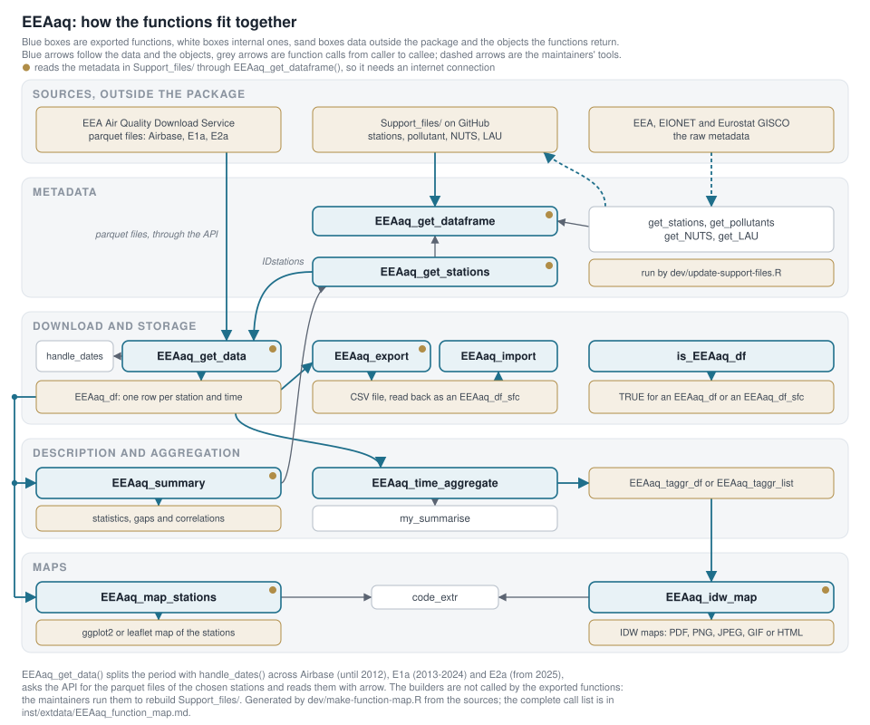

```{r setup, include = FALSE}
knitr::opts_chunk$set(collapse = TRUE, comment = "#>")
```

This vignette is the map of `EEAaq`: what each function is for, and how the
functions call one another. It is meant to be read once, before the manual
pages and the extended vignette.

```{r diagram, echo = FALSE, out.width = "100%", fig.alt = "Call graph of the EEAaq package in five bands: sources, metadata, download and storage, description and aggregation, maps"}

```

The same diagram, a PDF version and the complete list of the calls are
installed with the package:

```{r files, eval = FALSE}
system.file("extdata", "EEAaq_function_map.svg", package = "EEAaq")
system.file("extdata", "EEAaq_function_map.pdf", package = "EEAaq")
system.file("extdata", "EEAaq_function_map.md", package = "EEAaq")
```

## The five bands

### 1. Sources, outside the package

`EEAaq` stores no data. The measurements come from the EEA Air Quality
Download Service, which distributes them as parquet files in three
datasets: the historical Airbase data (until 2012), the verified E1a data
(2013-2024) and the up-to-date, unverified E2a data (from 2025). The
metadata (stations, pollutants, NUTS regions and LAU municipalities) come
from the EEA, the EIONET vocabulary and Eurostat GISCO; they change slowly
and need cleaning before they can be joined to the measurements, so the
maintainers prepare them and publish them in the folder `Support_files/` of
the GitHub repository.

### 2. Metadata

* `EEAaq_get_dataframe()` reads one of the four tables of `Support_files/`
  (`"stations"`, `"pollutant"`, `"NUTS"`, `"LAU"`). Every function marked by
  a dot in the diagram goes through it, so it needs an internet connection.
* `EEAaq_get_stations()` returns the stations (or their sampling points),
  with type, coordinates, NUTS regions and municipality: the place where the
  user chooses the stations, whose codes (`IDstations`) are the input of
  `EEAaq_get_data()`.
* `get_stations()`, `get_pollutants()`, `get_NUTS()` and `get_LAU()` are
  internal builders: no exported function calls them, and the maintainers
  run them through `dev/update-support-files.R` to rebuild `Support_files/`.

### 3. Download and storage

* `EEAaq_get_data()` asks the API of the download service for the parquet
  files of the chosen stations, pollutants and period, reads them with
  `arrow` and returns an `EEAaq_df`: one row per station and time step, one
  column per pollutant. `handle_dates()` splits the period across the three
  datasets.
* `is_EEAaq_df()` checks the class of an object.
* `EEAaq_export()` writes an `EEAaq_df` to a CSV or TXT file, and
  `EEAaq_import()` reads it back as an `EEAaq_df_sfc`.

### 4. Description and aggregation

* `EEAaq_summary()` describes an `EEAaq_df`, globally and station by
  station: descriptive statistics, missing values, length of the gaps and,
  with more than one pollutant, their correlations.
* `EEAaq_time_aggregate()` aggregates the series by year, month, week, day
  or hour with one or more statistics (computed by `my_summarise()`). With
  one pollutant it returns an `EEAaq_taggr_df`; with more, an
  `EEAaq_taggr_list` holding all of them (`TimeAggr`) and one
  `EEAaq_taggr_df` per pollutant (`TimeAggr_byPollutant`).

### 5. Maps

* `EEAaq_map_stations()` draws the stations of an `EEAaq_df` on a static
  (`ggplot2`) or interactive (`leaflet`) map, with NUTS or LAU borders.
* `EEAaq_idw_map()` interpolates an aggregated series by inverse distance
  weighting (`gstat`), one map per time step, and saves the maps as PDF,
  PNG, JPEG, GIF or HTML.

Both rely on `code_extr()` to read the level of the NUTS regions they draw.

## A typical session

```{r session, eval = FALSE}
library(EEAaq)
`%>%` <- dplyr::`%>%`

# 1. choose the stations: here, those of the province of Milano
IDstations <- EEAaq_get_stations(byStation = TRUE, complete = FALSE) %>%
  dplyr::filter(NUTS3 %in% c("Milano")) %>%
  dplyr::pull(AirQualityStationEoICode) %>%
  unique()

# 2. download the measurements
data <- EEAaq_get_data(IDstations = IDstations, pollutants = c("PM10", "NO2"),
                       from = "2024-01-01", to = "2024-01-15")

# 3. describe and aggregate them
summ   <- EEAaq_summary(data = data)
t_aggr <- EEAaq_time_aggregate(data = data, frequency = "daily", aggr_fun = "mean")

# 4. map the stations and interpolate the daily means
EEAaq_map_stations(data = data, NUTS_extborder = "NUTS2", NUTS_intborder = "LAU")
EEAaq_idw_map(data = t_aggr, pollutant = "NO2", aggr_fun = "mean",
              NUTS_filler = "NUTS3", NUTS_extborder = "NUTS2")
```

Every step except the aggregation reads from the internet; the extended
vignette runs the same session on data shipped with the package.

## Regenerating the map

The diagram and the list of the calls are generated by
`dev/make-function-map.R` in the GitHub repository of the package
(<https://github.com/PaoloMaranzano/EEAaq_R>), which finds the calls by a
static scan of the sources, so that the map cannot drift from the code:

```{r regenerate, eval = FALSE}
# from the root of the repository
source("dev/make-function-map.R")
```
