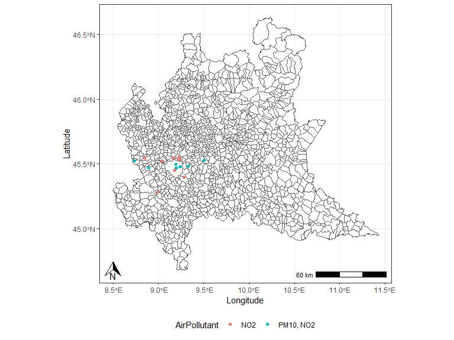
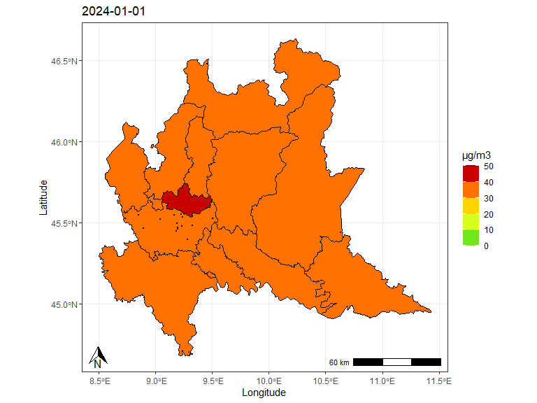
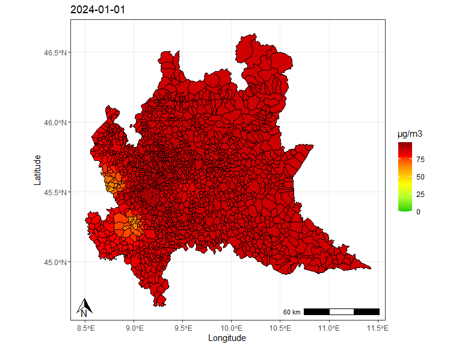

<!--
  This is the SOURCE of the vignette. Do not edit vignettes.Rmd by hand:
  edit this file and run, from the repository root,

      Rscript dev/precompute-vignette.R

  which evaluates the code below (internet access needed) and writes
  vignettes.Rmd with the results and the figures in vignettes/figures/.
  CRAN then builds vignettes.Rmd without running any code that needs the
  network.
-->


The **EEAaq package** allows users to retrieve air quality data for multiple geographical zones, pollutants, and time periods in a single request. Queries are submitted as lists, which enables flexibility in specifying combinations of parameters.

All the functions download information from the internet: the measurements from the EEA Air Quality Download Service and the metadata (stations, pollutants, NUTS and LAU boundaries) from the GitHub repository of the package. This vignette is therefore *precomputed*: its code was run by the maintainers on the date above, and the outputs below are the results of that run. The example data set downloaded in the first section ships with the package, so that the following sections can be reproduced from the same data:


``` r
library(EEAaq)
`%>%` <- dplyr::`%>%`
data <- readRDS(system.file("extdata", "vignette_data.rds", package = "EEAaq"))
```


# EEAaq_get_data
Below we demonstrate the use of query by using different combinations of user-defined arguments.

### Retrieve NO$_2$ and PM$_{10}$ data for the stations in the province of Milano

``` r
### Download NO2 and PM10 data for the province (NUTS-3) of Milano (Italy)
### from January 1st to January 15th, 2024
IDstations <- EEAaq_get_stations(byStation = TRUE, complete = FALSE)
IDstations <- IDstations %>%
  dplyr::filter(NUTS3 %in% c("Milano")) %>%
  dplyr::pull(AirQualityStationEoICode) %>%
  unique()
data <- EEAaq_get_data(IDstations = IDstations, pollutants = c("PM10", "NO2"),
                       from = "2024-01-01", to = "2024-01-15", verbose = TRUE)
```


``` r
# Preview the first few rows of the dataset
head(data)
#> # A tibble: 6 × 7
#>   AirQualityStationEoICode AirQualityStationName DatetimeBegin       DatetimeEnd        
#>   <chr>                    <chr>                 <dttm>              <dttm>             
#> 1 IT0477A                  MILANO - V.LE MARCHE  2024-01-01 01:00:00 2024-01-02 01:00:00
#> 2 IT0477A                  MILANO - V.LE MARCHE  2024-01-01 01:00:00 2024-01-01 02:00:00
#> 3 IT0477A                  MILANO - V.LE MARCHE  2024-01-01 02:00:00 2024-01-01 03:00:00
#> 4 IT0477A                  MILANO - V.LE MARCHE  2024-01-01 03:00:00 2024-01-01 04:00:00
#> 5 IT0477A                  MILANO - V.LE MARCHE  2024-01-01 04:00:00 2024-01-01 05:00:00
#> 6 IT0477A                  MILANO - V.LE MARCHE  2024-01-01 05:00:00 2024-01-01 06:00:00
#> # ℹ 3 more variables: AveragingTime <chr>, PM10 <dbl>, NO2 <dbl>
```


``` r
unique(data$AirQualityStationEoICode)
#>  [1] "IT0477A" "IT0480A" "IT0592A" "IT0694A" "IT0705A" "IT0706A" "IT0761A" "IT1010A"
#>  [9] "IT1016A" "IT1174A" "IT1203A" "IT1290A" "IT1294A" "IT1692A" "IT1792A" "IT2232A"
```

\
**Note 1**:
If the query's IDstations parameter corresponds to a valid *CITY_NAME* (i.e., not NULL in the dataset), the function will return the corresponding data. If no valid CITY_NAME is associated with the IDstations, the function attempts to retrieve all available data for the entire country and subsequently filter for the specified IDstations.
\

**Note 2**:
If the parameters used in the query include *polygon* or *quadrant*, the function outputs an EEAaq_df_sfc object. Otherwise, it returns an EEAaq_df object, which is a tibble dataframe.
\


# EEAaq_map_stations
`EEAaq_map_stations` generates a static or dynamic map of user-defined monitoring stations. The function accepts as input either an object of the `EEAaq_df` class (default output of the `EEAaq_get_data` function), or all other parameters specifying the area and the pollutants.


### Static map of the NO$_2$ and PM$_{10}$ monitoring stations in the province of Milano

``` r
EEAaq_map_stations(data = data,
                   NUTS_extborder = "NUTS2", NUTS_intborder = "LAU",
                   color = TRUE, dynamic = FALSE)
```

<div class="figure">

<p class="caption">plot of chunk map-static</p>
</div>
\
**Note**: The external borders are given by the union of the available regions (NUTS-2), while municipalities (LAUs) are used as inner borders.


### Dynamic (interactive) map of the same stations
The dynamic map is a leaflet widget that opens in the RStudio viewer or in the browser; it is not reproduced in this vignette.

``` r
EEAaq_map_stations(data = data,
                   NUTS_extborder = "NUTS2", NUTS_intborder = "NUTS3",
                   color = TRUE, dynamic = TRUE)
```


# EEAaq_summary
This function aims to describe the dataset that has been previously imported, both at a global level, which means considering the complete set of time stamps and monitoring stations in the dataset, and at the station-specific level, where summary statistics and information are grouped by monitoring station.
\
In addition to basic exploratory descriptive statistics (e.g., average pollutant concentration, variability, measures of skewness and kurtosis), the function provides information about the gap length and the correlation between pollutants if at least two pollutants are considered simultaneously.
\
The `EEAaq_summary` function receives as input an `EEAaq_df` object, i.e. the output of the `EEAaq_get_data` function.

### Compute the descriptive statistics

``` r
summ <- EEAaq_summary(data = data)
#> The dataset contains:
#>  ** 5488 total observations 
#>  ** 16 stations 
#>  ** 336 time stamps: from 2024-01-01 01:00:00 to 2024-01-15
```

### Global statistics

``` r
summ$Summary
#> # A tibble: 2 × 8
#>   Pollutant NA_count NA_perc negative_count   min  mean   max    sd
#>   <chr>        <int>   <dbl>          <int> <dbl> <dbl> <dbl> <dbl>
#> 1 PM10          5376   98.0               0 12.0   31.1  62.8  13.3
#> 2 NO2            201    3.66              0  2.63  37.6  98.4  16.4
```

### Station-specific statistics

``` r
summ$Summary_byStat$Mean_byStat
#> # A tibble: 16 × 4
#>    AirQualityStationEoICode AirQualityStationName      PM10   NO2
#>    <chr>                    <chr>                     <dbl> <dbl>
#>  1 IT0477A                  MILANO - V.LE MARCHE       31.1  37.6
#>  2 IT0480A                  SESTO S.GIOVANNI           31.1  37.6
#>  3 IT0592A                  RHO                        31.1  37.6
#>  4 IT0694A                  CINISELLO B.               31.1  37.6
#>  5 IT0705A                  MILANO - VERZIERE          31.1  37.6
#>  6 IT0706A                  LIMITO                     31.1  37.6
#>  7 IT0761A                  MILANO - V.LE LIGURIA      31.1  37.6
#>  8 IT1010A                  MAGENTA                    31.1  37.6
#>  9 IT1016A                  MILANO - SENATO            31.1  37.6
#> 10 IT1174A                  MOTTA VISCONTI             31.1  37.6
#> 11 IT1203A                  ARCONATE                   31.1  37.6
#> 12 IT1290A                  S. GIULIANO                31.1  37.6
#> 13 IT1294A                  TURBIGO                    31.1  37.6
#> 14 IT1692A                  MILANO PASCAL CITT� STUDI  31.1  37.6
#> 15 IT1792A                  CASSANO VIA MILANO         31.1  37.6
#> 16 IT2232A                  Cormano-Edison             31.1  37.6
```

### Linear correlation matrix

``` r
summ$Corr_Matrix
#> # A tibble: 16 × 4
#>    AirQualityStationEoICode AirQualityStationName     PM10_NO2 NO2_PM10
#>    <chr>                    <chr>                        <dbl>    <dbl>
#>  1 IT0477A                  MILANO - V.LE MARCHE            NA       NA
#>  2 IT0480A                  SESTO S.GIOVANNI                NA       NA
#>  3 IT0592A                  RHO                             NA       NA
#>  4 IT0694A                  CINISELLO B.                    NA       NA
#>  5 IT0705A                  MILANO - VERZIERE               NA       NA
#>  6 IT0706A                  LIMITO                          NA       NA
#>  7 IT0761A                  MILANO - V.LE LIGURIA           NA       NA
#>  8 IT1010A                  MAGENTA                         NA       NA
#>  9 IT1016A                  MILANO - SENATO                 NA       NA
#> 10 IT1174A                  MOTTA VISCONTI                  NA       NA
#> 11 IT1203A                  ARCONATE                        NA       NA
#> 12 IT1290A                  S. GIULIANO                     NA       NA
#> 13 IT1294A                  TURBIGO                         NA       NA
#> 14 IT1692A                  MILANO PASCAL CITT� STUDI       NA       NA
#> 15 IT1792A                  CASSANO VIA MILANO              NA       NA
#> 16 IT2232A                  Cormano-Edison                  NA       NA
```


# EEAaq_time_aggregate
Recall that most pollutants are monitored by EEA on a hourly or daily basis, posing challenges for interpretation and representation. The `EEAaq_time_aggregate` function simplifies this by aggregating data into annual, monthly, weekly, daily, or hourly intervals, generating summary statistics for each station in an `EEAaq_taggr_df` object.

### Station-specific monthly minimum, maximum, average and median concentrations of NO$_2$ and PM$_{10}$ in the province of Milano

``` r
t_aggr <- EEAaq_time_aggregate(
  data = data,
  frequency = "monthly",
  aggr_fun = c("min", "max", "mean", "median")
)
```

### Aggregated (monthly) data

``` r
t_aggr$TimeAggr
#> # A tibble: 16 × 11
#>    AirQualityStationEoICode AirQualityStationName   Date       PM10_min PM10_max PM10_mean
#>    <chr>                    <chr>                   <date>        <dbl>    <dbl>     <dbl>
#>  1 IT0477A                  MILANO - V.LE MARCHE    2024-01-01     16.9     62.3      34.5
#>  2 IT0480A                  SESTO S.GIOVANNI        2024-01-01     NA       NA        NA  
#>  3 IT0592A                  RHO                     2024-01-01     NA       NA        NA  
#>  4 IT0694A                  CINISELLO B.            2024-01-01     NA       NA        NA  
#>  5 IT0705A                  MILANO - VERZIERE       2024-01-01     12.0     47.3      27.1
#>  6 IT0706A                  LIMITO                  2024-01-01     16       57.7      33.6
#>  7 IT0761A                  MILANO - V.LE LIGURIA   2024-01-01     NA       NA        NA  
#>  8 IT1010A                  MAGENTA                 2024-01-01     13.8     62.8      32.2
#>  9 IT1016A                  MILANO - SENATO         2024-01-01     20.5     62.5      37.9
#> 10 IT1174A                  MOTTA VISCONTI          2024-01-01     NA       NA        NA  
#> 11 IT1203A                  ARCONATE                2024-01-01     NA       NA        NA  
#> 12 IT1290A                  S. GIULIANO             2024-01-01     NA       NA        NA  
#> 13 IT1294A                  TURBIGO                 2024-01-01     13.5     41.9      24.9
#> 14 IT1692A                  MILANO PASCAL CITT� ST… 2024-01-01     16       55.9      32  
#> 15 IT1792A                  CASSANO VIA MILANO      2024-01-01     12.4     45.9      26.8
#> 16 IT2232A                  Cormano-Edison          2024-01-01     NA       NA        NA  
#> # ℹ 5 more variables: PM10_median <dbl>, NO2_min <dbl>, NO2_max <dbl>, NO2_mean <dbl>,
#> #   NO2_median <dbl>
```

### PM$_{10}$ aggregated data only

``` r
t_aggr$TimeAggr_byPollutant$PM10
#> # A tibble: 16 × 7
#>    AirQualityStationEoICode AirQualityStationName     Date         min   max  mean median
#>    <chr>                    <chr>                     <date>     <dbl> <dbl> <dbl>  <dbl>
#>  1 IT0477A                  MILANO - V.LE MARCHE      2024-01-01  16.9  62.3  34.5   31.3
#>  2 IT0480A                  SESTO S.GIOVANNI          2024-01-01  NA    NA    NA     NA  
#>  3 IT0592A                  RHO                       2024-01-01  NA    NA    NA     NA  
#>  4 IT0694A                  CINISELLO B.              2024-01-01  NA    NA    NA     NA  
#>  5 IT0705A                  MILANO - VERZIERE         2024-01-01  12.0  47.3  27.1   26.8
#>  6 IT0706A                  LIMITO                    2024-01-01  16    57.7  33.6   29.8
#>  7 IT0761A                  MILANO - V.LE LIGURIA     2024-01-01  NA    NA    NA     NA  
#>  8 IT1010A                  MAGENTA                   2024-01-01  13.8  62.8  32.2   28  
#>  9 IT1016A                  MILANO - SENATO           2024-01-01  20.5  62.5  37.9   35.7
#> 10 IT1174A                  MOTTA VISCONTI            2024-01-01  NA    NA    NA     NA  
#> 11 IT1203A                  ARCONATE                  2024-01-01  NA    NA    NA     NA  
#> 12 IT1290A                  S. GIULIANO               2024-01-01  NA    NA    NA     NA  
#> 13 IT1294A                  TURBIGO                   2024-01-01  13.5  41.9  24.9   22.6
#> 14 IT1692A                  MILANO PASCAL CITT� STUDI 2024-01-01  16    55.9  32     31.5
#> 15 IT1792A                  CASSANO VIA MILANO        2024-01-01  12.4  45.9  26.8   23.2
#> 16 IT2232A                  Cormano-Edison            2024-01-01  NA    NA    NA     NA
```


# EEAaq_idw_map
To enable quick and intuitive visual analysis, the `EEAaq_idw_map` function provides spatial interpolation maps using the Inverse Distance Weighting (IDW) method (Shepard, 1968). This technique estimates the value of a variable at unknown locations by calculating a weighted average of known values, with weights inversely proportional to the distance from known points. Closer points contribute more heavily to the estimate, making it a practical approach for interpolating geolocated air quality data.

### IDW map of the monthly average concentration of NO$_2$ in the province of Milano, averaged by province (NUTS-3)

``` r
EEAaq_idw_map(data = t_aggr, pollutant = "NO2", aggr_fun = "mean",
              distinct = TRUE, gradient = FALSE,
              dynamic = FALSE,
              NUTS_filler = "NUTS3", NUTS_extborder = "NUTS2")
#> Map initialization started at 2026-11-20 16:12:46.24892
#> Map initialization ended at 2026-11-20 16:12:53.304368
#> Computing IDW interpolation started at 2026-11-20 16:12:53.305184
#> Computing IDW interpolation for: 2024-01-01, 1 of 1
#> [inverse distance weighted interpolation]
#> Computing IDW interpolation ended at 2026-11-20 16:12:58.482091
#> [[1]]
```

<div class="figure">

<p class="caption">plot of chunk idw-mean</p>
</div>


``` r
t_aggr$TimeAggr_byPollutant$NO2
#> # A tibble: 16 × 7
#>    AirQualityStationEoICode AirQualityStationName     Date         min   max  mean median
#>    <chr>                    <chr>                     <date>     <dbl> <dbl> <dbl>  <dbl>
#>  1 IT0477A                  MILANO - V.LE MARCHE      2024-01-01 25.1   96.3  50.4   48.5
#>  2 IT0480A                  SESTO S.GIOVANNI          2024-01-01 16.9   98.4  48.7   48.4
#>  3 IT0592A                  RHO                       2024-01-01 14.4   95.0  38.9   38.1
#>  4 IT0694A                  CINISELLO B.              2024-01-01  9.87  98.1  42.8   41.5
#>  5 IT0705A                  MILANO - VERZIERE         2024-01-01 20.9   97.3  47.9   44.9
#>  6 IT0706A                  LIMITO                    2024-01-01  8.05  82.0  38.0   36.0
#>  7 IT0761A                  MILANO - V.LE LIGURIA     2024-01-01 22.0   98.2  39.9   35.8
#>  8 IT1010A                  MAGENTA                   2024-01-01  5.60  88.5  32.2   30.4
#>  9 IT1016A                  MILANO - SENATO           2024-01-01 12.9   87.7  45.4   43.5
#> 10 IT1174A                  MOTTA VISCONTI            2024-01-01  7.51  60.4  22.6   20.4
#> 11 IT1203A                  ARCONATE                  2024-01-01  5.54  66.2  25.2   23.3
#> 12 IT1290A                  S. GIULIANO               2024-01-01  8.49  89.3  33.6   29.8
#> 13 IT1294A                  TURBIGO                   2024-01-01  4.51  57.9  22.4   20.4
#> 14 IT1692A                  MILANO PASCAL CITT� STUDI 2024-01-01  2.63  90.6  36.1   33.8
#> 15 IT1792A                  CASSANO VIA MILANO        2024-01-01 10.4   78.8  37.1   35.3
#> 16 IT2232A                  Cormano-Edison            2024-01-01 12.3   86.2  41.4   39.2
```

### IDW map of the maximum monthly concentration of NO$_2$, averaged by municipality (LAU)

``` r
EEAaq_idw_map(
  data = t_aggr$TimeAggr_byPollutant$NO2 %>% dplyr::filter(Date %in% c("2024-01-01", "2024-02-01")),
  pollutant = "NO2",
  aggr_fun = "max",
  distinct = TRUE,
  gradient = TRUE,
  idp = 2, NUTS_extborder = "NUTS2", NUTS_filler = "LAU"
)
#> Map initialization started at 2026-11-20 16:12:59.050935
#> Map initialization ended at 2026-11-20 16:13:07.305275
#> Computing IDW interpolation started at 2026-11-20 16:13:07.306953
#> Computing IDW interpolation for: 2024-01-01, 1 of 1
#> [inverse distance weighted interpolation]
#> Computing IDW interpolation ended at 2026-11-20 16:13:14.333263
#> [[1]]
```

<div class="figure">

<p class="caption">plot of chunk idw-max</p>
</div>
